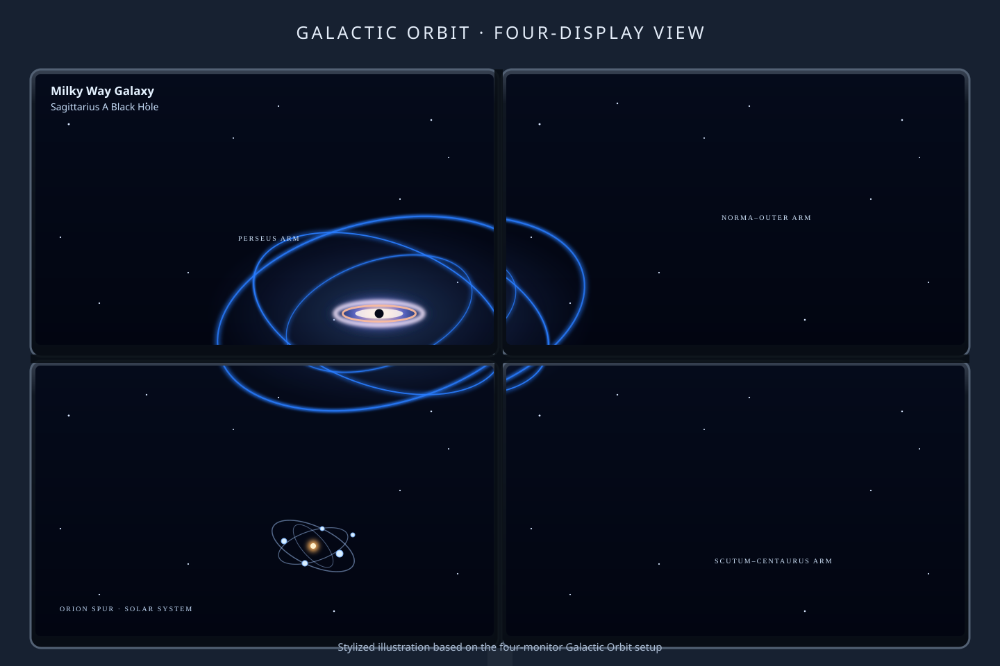
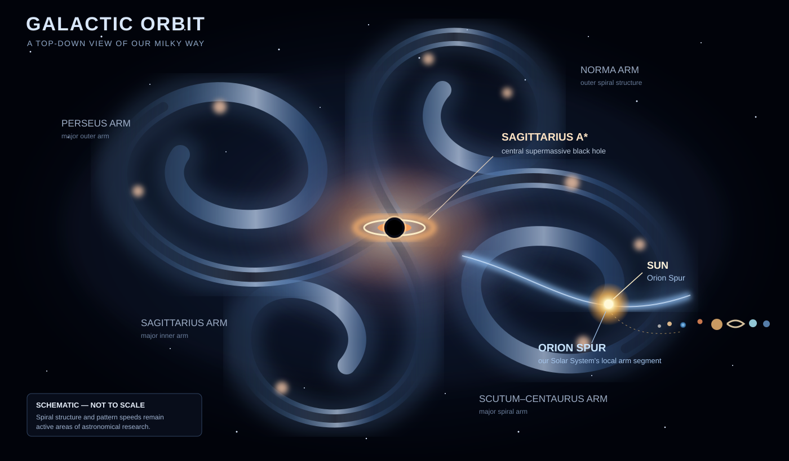

# Galactic Orbit

<p align="center">
  
</p>

<p align="center"><em>Four-monitor setup — a stylized illustration based on the real workstation installation.</em></p>

The scene is designed as one continuous view across all four displays, with the galactic center spanning the monitor junctions.

<details>
<summary>Conceptual view of the Milky Way scene</summary>
<p align="center">
  
</p>
<p><em>Schematic overview, not to scale and not a live renderer screenshot.</em></p>
</details>

Galactic Orbit is an animated Milky Way and Solar System visualization for Linux, with a KDE Plasma 6 wallpaper integration designed to work as a **KScreenLocker background**. The scene is intended to span a multi-monitor desktop as one continuous galactic canvas.

The project includes two renderers:

- **Plasma 6 integration:** a procedural OpenGL shader rendered as synchronized per-display slices, using shared virtual-desktop coordinates. The scene stays aligned across monitor boundaries.
- **Standalone preview:** an SDL3/OpenGL application with a texture-mapped Sun and planets. It can open a window on one display or a borderless window spanning the virtual desktop.

## Current visualization

The current Plasma scene includes:

- A broad, tilted, face-on Milky Way with a luminous central bulge, textured spiral structure, dust lanes, star fields, and blue-violet outer regions.
- **Sagittarius A*** at the galactic center, shown as a compact dark event horizon with a detailed, high-contrast accretion disk and photon ring.
- Five subtle labels identifying the **Norma–Outer Arm**, **Scutum–Centaurus Arm**, **Sagittarius–Carina Arm**, **Perseus Arm**, and **Orion Spur**. The labels follow the slow galactic rotation.
- The Sun positioned on the Orion Spur, with the planetary system orbiting around it.
- Eight planets with bundled surface textures and a shared orbital plane inclined 60° to the viewing direction. The circular paths project as ellipses in the top-down view.
- A two-line title, **“Milky Way Galaxy”** and **“Sagittarius A Black Hole,”** shown once in the upper-left display.

The shader layer is rendered at half physical resolution and smoothly upscaled to reduce GPU load; the text labels are drawn separately so they remain crisp.

The visualization is illustrative rather than a scale model. Galactic dimensions, distances, orbital periods, and animation rates are compressed or accelerated for viewing. The Milky Way's detailed spiral structure and pattern speed are not known with certainty.

## Automated builds and releases

GitHub Actions builds packages when code is pushed and publishes release files when a version tag is pushed.

### Build a release

1. Merge or push the release-ready code to `main`.
2. Create and push a version tag, for example:

   ```bash
   git tag v0.1.0
   git push origin v0.1.0
   ```

3. Open the repository's **Actions** tab and watch the **Build and Release** workflow.
4. When all required jobs pass, GitHub creates a Release for the tag and attaches the generated packages.

The workflow currently produces:

| Platform | Release asset | Notes |
|---|---|---|
| Enterprise Linux 10 x86_64 | RPM and source RPM | Built in an AlmaLinux 10 container; intended for AlmaLinux, Rocky Linux, Oracle Linux, and CentOS Stream 10. Runtime dependency availability should still be checked on each distribution. |
| Windows 10/11 x64 | ZIP | Standalone executable, SDL3 runtime DLL, and planet textures. |
| Windows 10/11 x64 | MSI | Per-machine installer built with WiX Toolset. |

The RPM package version and Windows package version are currently taken from the packaging metadata/workflow. Update those when preparing a new product version; a release tag alone does not change the embedded package version.

### Solaris status

Solaris is not yet a release target. GitHub-hosted Actions runners do not provide a native Solaris environment, and the project currently depends on SDL3/OpenGL. A genuine Solaris build needs a supported Solaris build host/toolchain and SDL3 development libraries. We will add a Solaris archive or native package after that environment is available and the build is verified; the Linux RPM is not a Solaris substitute.

## Install on AlmaLinux 10

The recommended installation is the RPM, which packages the standalone preview, bundled planetary textures, and KDE Plasma 6 wallpaper integration.

### Build dependencies

Enable the CRB repository and install the development packages:

```bash
sudo dnf install -y epel-release dnf-plugins-core
sudo dnf config-manager --set-enabled crb
sudo dnf install -y rpm-build rpmdevtools cmake gcc-c++ make SDL3-devel \
  mesa-libGL-devel extra-cmake-modules libplasma-devel kf6-kcoreaddons-devel \
  qt6-qtbase-devel qt6-qtdeclarative-devel qt6-qtshadertools-devel
```

### Build the RPM

Run these commands from the repository root:

```bash
mkdir -p ~/rpmbuild/{BUILD,BUILDROOT,RPMS,SOURCES,SPECS,SRPMS}
cp packaging/galacticorbit-screensaver.spec ~/rpmbuild/SPECS/
git archive --format=tar.gz --prefix=galacticorbit-screensaver-0.1.0/ HEAD \
  > ~/rpmbuild/SOURCES/galacticorbit-screensaver-0.1.0.tar.gz
rpmbuild -ba ~/rpmbuild/SPECS/galacticorbit-screensaver.spec
```

Install the resulting RPM:

```bash
sudo dnf install ~/rpmbuild/RPMS/x86_64/galacticorbit-screensaver-*.rpm
```

For the full packaging notes, see [packaging/README.md](packaging/README.md).

## Select it as the KDE lock-screen background

1. Open **System Settings → Screen Locking**.
2. Open the **Appearance** section and choose **Configure Appearance…** if shown.
3. Select **Galactic Orbit** as the wallpaper/background.
4. Apply the setting and press **Meta+L** to test it.

The desktop wallpaper and lock-screen background are configured independently. Select Galactic Orbit in the lock-screen settings, not the ordinary desktop Wallpaper settings.

Galactic Orbit supplies only the background. KDE's normal lock-screen interface and password authentication remain in place; this project does not replace or bypass screen-lock security.

## Build from source

### Standalone SDL3/OpenGL preview

Install the standalone build dependencies:

```bash
sudo dnf install -y gcc-c++ cmake make SDL3-devel mesa-libGL-devel
```

Planetary texture maps are bundled in `assets/planet-textures/`; no download step is required for a normal build.

```bash
cmake -S . -B build -DCMAKE_BUILD_TYPE=Release
cmake --build build --parallel
```

Run the preview:

```bash
./build/galacticorbit-screensaver
```

The default mode opens a borderless window spanning the virtual desktop. Other useful options:

| Command | Purpose |
|---|---|
| `./build/galacticorbit-screensaver --windowed` | Open a 1280×720 window on one display |
| `./build/galacticorbit-screensaver --windowed-span` | Open a borderless window spanning the virtual desktop |
| `./build/galacticorbit-screensaver --speed 1.5` | Start with a faster animation rate |
| `./build/galacticorbit-screensaver --help` | Show command-line usage |

On Wayland, compositor behavior can affect how a single SDL window spans multiple outputs. The Plasma integration is the preferred multi-monitor implementation because each output renders its own synchronized slice.

### KDE Plasma 6 integration

Install the Plasma development packages listed in the RPM build dependencies, then configure and build with the Plasma integration enabled:

```bash
cmake -S . -B build-plasma -DCMAKE_BUILD_TYPE=Release \
  -DGALACTICORBIT_BUILD_PLASMA6=ON
cmake --build build-plasma --parallel
sudo cmake --install build-plasma
```

For normal use, prefer installing the RPM so the wallpaper package, geometry plugin, shader resources, and texture assets are installed in their expected system locations.

## Standalone preview controls

| Key | Action |
|---|---|
| `Esc` or `Q` | Quit |
| `Space` | Pause or resume |
| `R` | Reset animation time |
| `+` / `-` | Increase / decrease animation speed |
| `F` | Toggle fullscreen |

## Project layout

- `src/` — standalone SDL3/OpenGL renderer.
- `assets/planet-textures/` — bundled Solar System texture maps.
- `packaging/plasma6/` — KDE Plasma 6 wallpaper package, geometry helper, and procedural fragment shader.
- `packaging/galacticorbit-screensaver.spec` — AlmaLinux RPM specification.
- `.github/workflows/` — automated build workflow.

## License

The application is licensed under **GNU GPL-3.0-only**; see [LICENSE](LICENSE). Planetary texture maps have their own upstream attribution and license terms; consult the included asset/source notes before redistributing those files.
